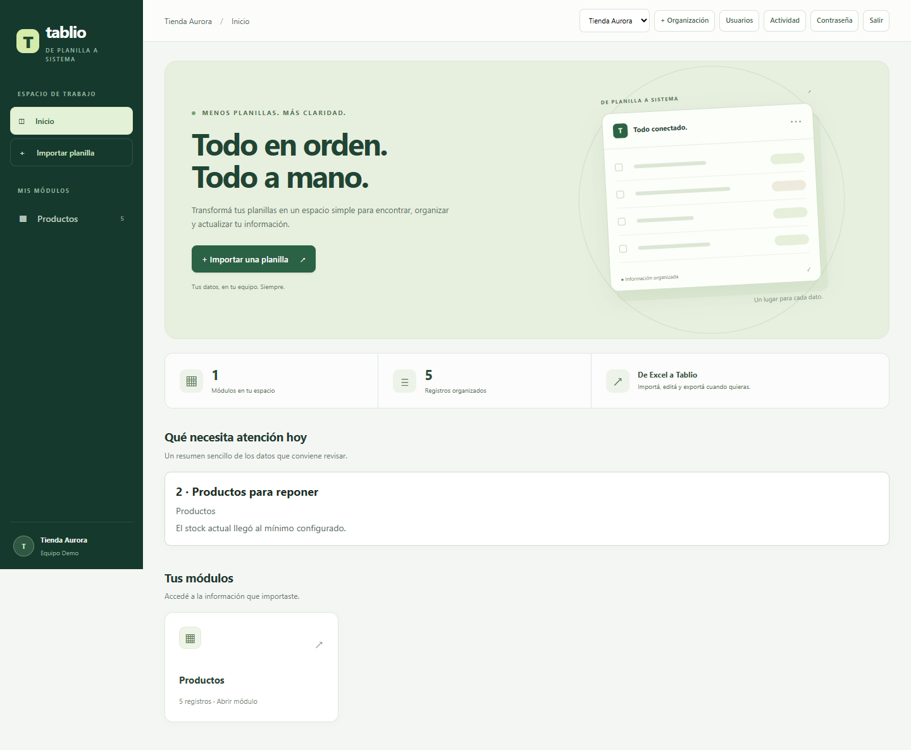
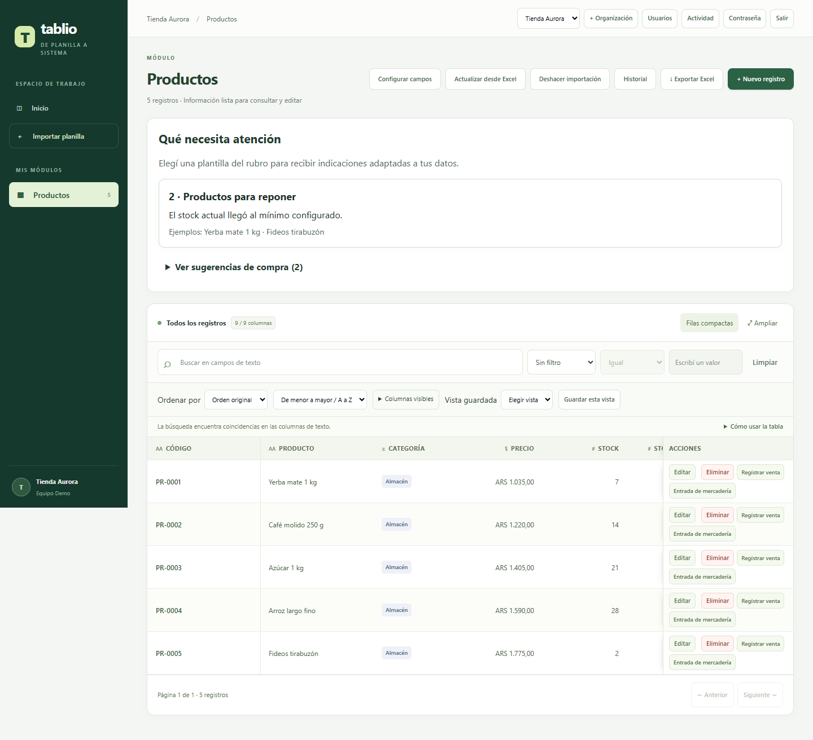
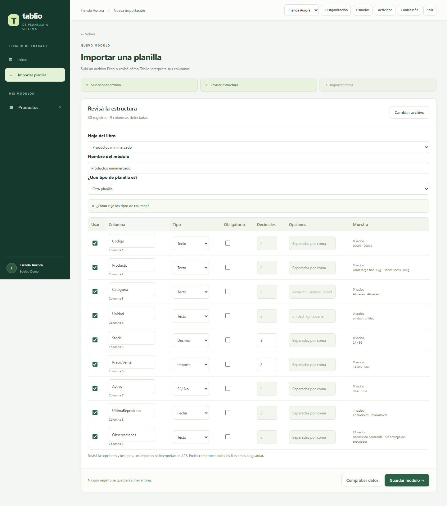
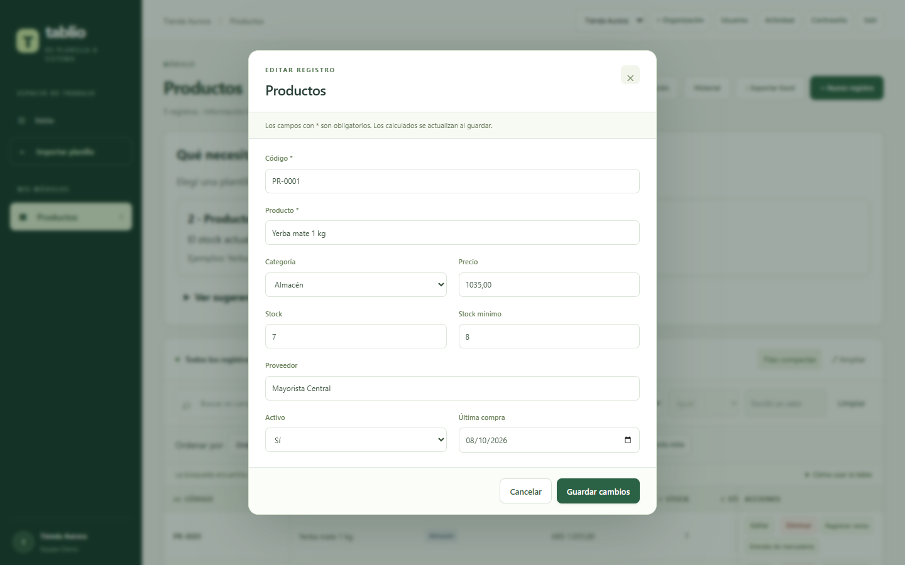

<p align="center">
  
</p>

<p align="center">
  <strong>Convertí una planilla de Excel en un sistema sencillo para trabajar todos los días.</strong><br>
  Importá, revisá y actualizá tus datos desde el navegador, sin abandonar el archivo que ya usás.
</p>

> **Estado:** Proof of Concept funcional para uso local. El despliegue público con HTTPS aún necesita servidor, dominio y validación operativa.

## Qué podés hacer

| | Función |
|---|---|
| 📥 | **Importar XLSX con revisión previa.** Elegí la hoja, comprobá tipos y datos, corregí fórmulas simples o excluí una fila problemática. Las celdas combinadas se señalan para revisión. |
| 🗂️ | **Trabajar con módulos.** Consultá, buscá, filtrá, ordená, editá y exportá registros. Podés configurar campos y guardar vistas personales. |
| 🔄 | **Actualizar desde Excel.** Compará registros nuevos, modificados y sin cambios antes de guardar. Si un identificador se repite, Tablio puede sugerir una combinación de hasta tres columnas. El historial permite deshacer una actualización cuando los registros afectados no se editaron después. |
| 📦 | **Seguir el trabajo diario.** Registrá ventas y entradas de mercadería en módulos con stock; consultá avisos y sugerencias de reposición explicadas. |
| 🔐 | **Separar equipos y datos.** Inicio de sesión, roles, organizaciones aisladas, actividad y copias de seguridad locales. |

## La interfaz

El inicio muestra los módulos, la cantidad de registros y los avisos que necesitan atención. En cada módulo, la tabla permite buscar, filtrar, ordenar y elegir columnas. Para planillas anchas, la tabla conserva los encabezados y las acciones visibles mientras desplazás el contenido; **Ampliar** usa toda la pantalla y **Esc** vuelve a la vista normal. Las vistas guardadas recuerdan la búsqueda, los filtros, el orden y las columnas.

Las capturas siguientes muestran la aplicación con datos ficticios de demostración. Podés ver los archivos originales en [`docs/images/`](docs/images/README.md).

| Inicio y módulos | Registros y filtros |
|---|---|
|  |  |
| Importación | Edición de un registro |
|  |  |

## Empezar en tu computadora

Necesitás **Python 3.11 o superior**. Abrí la carpeta del repositorio en Visual Studio Code y usá su terminal. No hay paquetes externos que instalar.

1. Creá la cuenta propietaria (solo la primera vez):

   ```powershell
   python -m app.admin --email vos@ejemplo.com --name "Tu nombre" --organization "Mi organización"
   ```

   El comando te pedirá una contraseña de al menos 12 caracteres. Usá ese correo para iniciar sesión.

2. Iniciá Tablio:

   ```powershell
   python -m app.server
   ```

   En VS Code también podés elegir **Ejecutar y depurar → Iniciar Tablio (repositorio Git)**.

3. Abrí **[http://127.0.0.1:8000](http://127.0.0.1:8000)**. Para detener el servidor, presioná **Ctrl+C** en la terminal. Si el puerto ya está ocupado, Tablio lo indica en lugar de iniciar otra instancia.

### Tu primera importación

Probá con los archivos sintéticos [minimercado.xlsx](outputs/01a06e97-c8d6-7c20-aebd-4c816513d8af/minimercado.xlsx) o [corralon_materiales.xlsx](outputs/01a06e97-c8d6-7c20-aebd-4c816513d8af/corralon_materiales.xlsx):

1. Elegí **Importar una planilla** y seleccioná un archivo.
2. En **Revisar estructura**, comprobá las columnas y pulsá **Comprobar datos**. Si hay errores, corregí la celda o excluí solo la fila afectada.
3. Pulsá **Guardar módulo**. Después podés buscar registros, editarlos o usar **Actualizar desde Excel** para revisar nuevos datos antes de aplicarlos.

Las fórmulas aritméticas simples de la misma fila se pueden recalcular. Si una fórmula no es compatible pero Excel guardó un resultado válido, Tablio avisa que ese valor se importará como fijo.

## Datos y límites actuales

- El servidor local escucha en `127.0.0.1:8000` y guarda la base SQLite en `data/tablio.sqlite3`.
- Los XLSX pendientes se guardan de forma privada en `uploads/` y vencen a las 24 horas. `data/`, `uploads/` y `backups/` no se versionan.
- Cada archivo puede ocupar hasta **5 MiB**; el lector admite hasta **5.000 registros** y **64 columnas** por hoja.
- Docker Compose y Caddy preparan HTTPS, pero el despliegue público sigue pendiente de infraestructura y pruebas. Consultá [acceso, backups y despliegue](docs/SECURITY_DEPLOYMENT.md) antes de usar datos reales fuera de una prueba controlada.

## Documentación

| Documento | Para qué sirve |
|---|---|
| [Project Brief](Tablio%20%E2%80%94%20Project%20Brief.md) | Visión, alcance y criterios del producto. |
| [Planificación](docs/PLANNING.md) | Avances realizados y trabajo pendiente. |
| [Arquitectura](docs/ARCHITECTURE.md) | Componentes y flujo de datos. |
| [Decisiones](docs/DECISIONS.md) | Motivos de las elecciones técnicas y de producto. |
| [Archivos de prueba](docs/FIXTURES.md) | Contenido de los XLSX sintéticos incluidos. |

Para ejecutar las pruebas:

```powershell
python -m unittest discover -s tests -v
```

El código está organizado en `app/` (servidor y datos), `web/` (interfaz), `tests/` (pruebas) y `docs/` (documentación).
