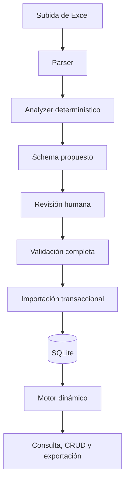

# Arquitectura

## Estado y dirección

El brief establece una preferencia por aplicaciones dinámicas basadas en metadatos y confirmación humana. V0 ya tiene una implementación local ejecutable. La decisión R-004 de DECISIONS.md registra el cambio de stack respecto de la propuesta inicial. Las reglas de datos siguen en [POC_SPEC.md](POC_SPEC.md).

## Implementación vigente de V0

| Capa | Implementación |
|---|---|
| Servidor | Python 3.11+, `http.server`, limitado a 127.0.0.1 |
| XLSX | Lector y exportador acotados con `zipfile` y XML de la biblioteca estándar |
| Metadatos y datos | SQLite, esquema JSON versionado y registros JSON |
| Interfaz | HTML, CSS y JavaScript sin framework, responsive |
| Pruebas | `unittest` con ambos libros y recorridos HTTP locales |

El código está en `app/`, `web/` y `tests/`. No necesita dependencias externas. Esta elección sirve al PoC local; no sustituye la evaluación del stack de un MVP con usuarios y organizaciones reales.

## Estructura propuesta

Un monolito modular: un servidor local, una base SQLite y responsabilidades internas separadas.

## Componentes

| Componente | Responsabilidad |
|---|---|
| Parser | Leer hojas, celdas y formatos; conservar coordenadas de origen |
| Analyzer | Proponer tipos y señalar ambigüedades e incompatibilidades |
| Schema Validator | Verificar metadatos y reglas de registros |
| Revisión | Presentar muestras y permitir correcciones antes de importar |
| Importer | Convertir todos los valores e insertar de manera atómica |
| Dynamic App Engine | Construir listados, detalles y formularios desde el schema |
| Acceso a datos | Aplicar contexto de organización y consultas permitidas |
| Exportador | Generar XLSX con los datos actuales y tipos admitidos |

La lógica de análisis, conversión y validación reside en `app/core.py`, separada de la interfaz en `web/`. Una eventual capa de IA podrá proponer cambios sobre el schema; el motor seguirá validando y ejecutando determinísticamente.

## Stack originalmente propuesto (histórico)

| Capa | Tecnología | Justificación |
|---|---|---|
| Lenguaje | TypeScript | Contratos compartidos entre interfaz y servidor |
| Aplicación | Next.js + React, runtime Node.js | UI y endpoints en un proyecto |
| Persistencia | PostgreSQL | Metadatos relacionales y registros en JSONB |
| XLSX | ExcelJS | Lectura y exportación |
| Validación | Zod | Validación en ejecución a partir de los tipos admitidos |
| UI | Componentes React reutilizables y CSS responsive | Experiencia consistente y móvil |

Esta tabla documenta la propuesta previa Next.js/PostgreSQL, que no se implementó en V0. Ver R-004. No se seleccionó proveedor de hosting.

Referencias técnicas consultadas durante el diseño: [Next.js Route Handlers](https://nextjs.org/docs/app/getting-started/route-handlers), [ExcelJS](https://www.npmjs.com/package/exceljs), [Zod](https://zod.dev/) y [PostgreSQL JSONB](https://www.postgresql.org/docs/16/datatype-json.html). Estas referencias sustentan capacidades, no representan dependencias ya instaladas.

## Política de análisis propuesta

- Admitir una tabla rectangular con encabezados en la primera fila.
- Rechazar encabezados vacíos o duplicados en columnas utilizadas.
- Interpretar fórmulas aritméticas simples de la misma fila, listar y corregir errores durante la revisión; seguir rechazando celdas combinadas.
- Usar valores y formatos como evidencia; los nombres de columnas son señales secundarias.
- Proponer configuración regional es-AR y hacerla visible durante la revisión.
- No convertir silenciosamente fechas o números ambiguos.
- Permitir confirmar enumeraciones y obligatoriedad; no asumirlas por ausencia de vacíos o repetición de valores.
- Validar todos los registros después de las correcciones, aunque la interfaz muestre solo una muestra.

## Integridad de importación

La confirmación referencia una importación y una versión concreta del schema revisado. La creación de la entidad y sus registros se ejecuta en una transacción. Un error impide publicar datos parciales.

Reintentar una confirmación ya completada devuelve su resultado sin insertar registros nuevos. La reimportación posterior usa una columna identificadora elegida por el usuario: compara el XLSX con registros existentes, muestra altas y cambios, rechaza claves duplicadas y aplica la operación en una transacción. La confirmación exige el resumen exacto revisado; un cambio de datos obliga a obtener otra vista previa. El historial permite deshacer mientras ninguno de los registros afectados se haya modificado después.

## Seguridad y contexto de organización

La implementación actual exige login y asigna roles por organización. Cada solicitud API valida sesión y membresía; las escrituras también validan CSRF. Las consultas de módulos, registros e importaciones se acotan por organización. Hay pruebas de acceso cruzado entre organizaciones y de permisos por rol. La infraestructura pública y la operación de producción siguen pendientes.

En toda escritura, el servidor valida el registro contra el schema. Los filtros se limitan a campos y operadores conocidos, y las consultas usan parámetros. La interfaz no es una frontera de autorización.

## Archivos y despliegue

Archivos temporales fuera de rutas públicas, identificados internamente y eliminados al finalizar o a las 24 horas de recepción. Ejecutar limpieza al iniciar la aplicación y antes de aceptar subidas. Límites de diseño: 5 MiB comprimidos y 50 MiB descomprimidos, además de 5.000 filas y 30 columnas. Verificar su costo de procesamiento antes de considerar demostrada esa capacidad.

Ejecución local: `python -m app.server`, SQLite en `data/` y primer propietario creado por `python -m app.admin`. Docker Compose separa la app, el servicio de backup y Caddy. El proxy publicará HTTPS cuando exista un dominio y servidor; actualmente no hay despliegue. Ver SECURITY_DEPLOYMENT.md para configuración, restauración y tareas operativas pendientes.

No se proponen microservicios, colas, generación de proyectos por cliente ni aplicaciones móviles nativas para V0.
